# CS6650 Assignment 4 Report

## Submission Information

Repository URL:
`https://github.khoury.northeastern.edu/odieyangkhoury/cs6650-assignment4`

Team members:

| Name | Primary Responsibility |
|---|---|
| Yunhong Huang | Load tester and result artifacts |
| Qingyu Cheng | KV node core and Leader-Follower logic |
| Runxin Shao | Leaderless logic and unit tests |
| Ziqi Yang | Infrastructure, deployment, report, and final integration hardening |

## Walkthrough Recording

Yunhong Huang load tester and results walkthrough:
[Yunhong Huang Load Tester Walkthrough Video](https://northeastern.zoom.us/rec/share/ks6EGCPciflw-66xUveLfJGYJkV_cbd9lTLMtica6OalBsnKplPdq9n5yZuB2ZJU.f70iWCePMZItMgui?startTime=1775594981000)

Recording passcode: `YdMwWQ3+`

## 1. System Summary

This project evaluates two replicated in-memory key-value store designs with five
nodes:

- **Leader-Follower**: one leader accepts client writes and replicates updates to
  four followers. Tested quorum configurations: W=5/R=1, W=3/R=3, and W=1/R=5.
- **Leaderless**: any node can coordinate a write. The coordinator writes locally
  and propagates to all four peers. Tested configuration: W=N=5, R=1.

Every node applies a 200 ms delay before committing a write and a 50 ms delay
before returning a read. Replication is intentionally sequential so the quorum
size is directly observable in latency:

- Expected write latency ≈ W × 200 ms
- Expected read latency ≈ R × 50 ms

## 2. Implementation Scope

The KV service exposes:

| Method | Endpoint | Purpose |
|---|---|---|
| PUT | `/kv` | Client write |
| GET | `/kv?key=<key>` | Client read |
| GET | `/local_read?key=<key>` | Local-only consistency probe (testing) |
| PUT | `/kv/internal` | Internal replication write |
| GET | `/kv/internal?key=<key>` | Internal local read for quorum reads |

Version numbers are monotonically increasing integers assigned by the write
coordinator. Version 1 is assigned on the first write to a key; each subsequent
write increments it. When R > 1, the read coordinator collects R responses and
returns the value with the highest version.

Final integration hardening (Ziqi Yang):

- `KvStore.putWithVersion` rejects incoming replication writes whose version is
  lower than the currently stored version, preventing out-of-order overwrites.
- `503 Service Unavailable` returned when quorum requirements cannot be met.
- Follower nodes reject client-facing `PUT /kv` with `503`.
- Load tester: writes route to the leader; reads distribute round-robin across
  all five nodes.
- Separate Docker Compose files for Leader-Follower and Leaderless modes.
- Terraform security-group hardening and verified target-group health checks.

## 3. Load Tester Design

### How the Load Tester Works

The load tester (`LoadTesterApplication.java`) runs a fixed-size thread pool for
a configurable duration. Each iteration independently decides write vs. read:

```
isWrite = rand.nextDouble() < writeRatio
key     = "key" + rand.nextInt(keySpace)
```

Both operations draw from the same **100-key pool**. With 32 threads and 100
keys each key receives writes at a rate of roughly `32 × writeRatio / 100`
writes per second. At 10% writes that is ~3 writes/key/second, with reads
arriving ~27× more frequently on the same key. This creates dense
read-after-write clusters that land inside the inconsistency window for W=1,
making stale reads observable even over a ten-minute run.

### Staleness Detection

A `ConcurrentHashMap<String, Integer> lastWrittenVersion` is shared across all
threads. After each successful write the thread stores
`max(current, response_version)` for that key. After each successful read the
thread compares the returned version against the stored value; a lower version
is flagged as stale in the CSV. A 404 on an uninitialized key is not counted
as stale.

### CSV Output

| Field | Meaning |
|---|---|
| `timestamp_ms` | Request start time (epoch ms) |
| `type` | `READ` or `WRITE` |
| `key` | Key name (e.g. `key42`) |
| `latency_ms` | End-to-end request latency |
| `version` | Version returned by the service |
| `stale` | `true` if response version < last known write version |

### Read Target Distribution

For Leader-Follower, writes go to `--write-target` (the leader); reads are
distributed round-robin across `--read-targets` (all five nodes). For
Leaderless, writes go to a single designated peer (bypassing the ALB to avoid
health-check timeout issues in Vocareum's environment), while reads are
distributed round-robin across all five private IPs. This is functionally
equivalent to the ALB design because any leaderless node can act as the write
coordinator.

## 4. Experimental Method

The matrix crosses four configurations × four write ratios = 16 runs, each
600 seconds with 32 concurrent threads on EC2 (us-east-1, `t3.micro`).

| Write Ratio | Read Ratio |
|---:|---:|
| 1% | 99% |
| 10% | 90% |
| 50% | 50% |
| 90% | 10% |

### AWS Deployment

| Resource | Value |
|---|---|
| AMI | `ami-098e39bafa7e7303d` |
| Leader URL | `http://54.88.217.77:8080` |
| Leaderless ALB | `http://cs6650-a4-leaderless-alb-979545484.us-east-1.elb.amazonaws.com` |
| Load tester IP | `44.201.122.164` |

| Node | Private IP | Role |
|---|---|---|
| 1 | `10.20.1.90` | leader |
| 2 | `10.20.2.202` | follower |
| 3 | `10.20.1.205` | follower |
| 4 | `10.20.2.218` | follower |
| 5 | `10.20.1.115` | follower |

| Check | Result |
|---|---|
| All six EC2 instances | `running` |
| ALB state | `active` |
| All five KV target-group members | `healthy` |
| Leader-Follower smoke write | `201 Created`, all four followers replicated |
| Load tester smoke | W=5/R=1, 10% writes, 2 threads, 8 s → 0 stale reads |

## 5. Results and Analysis

All latency data and graphs come from the full AWS dataset (600 s, 32 threads).
Total rows across all 16 runs: ~2.1 million.

---

### 5.1 Leader-Follower W=5 / R=1

The leader must receive acknowledgment from all four followers before returning
to the client (W=5). Reads are served by the leader's local store (R=1).

#### Read Latency


Read latency is a sharp spike at 51 ms with negligible spread (p95 = 52 ms).
This is exactly one 50 ms sleep because R=1 — the receiving node reads its
local value and returns with no further coordination. There is no dependency on
quorum size here; every read costs a single fixed sleep regardless of how many
writes are in flight.

#### Write Latency


Write latency clusters tightly at 1,006 ms (p95 = 1,012 ms). The leader
sequentially calls all four followers with a 200 ms sleep each:
5 × 200 ms = 1,000 ms, plus ~6 ms for five EC2 LAN round-trips. The tight
distribution with no tail reflects the deterministic nature of the fixed sleeps.

#### Read-After-Write Interval

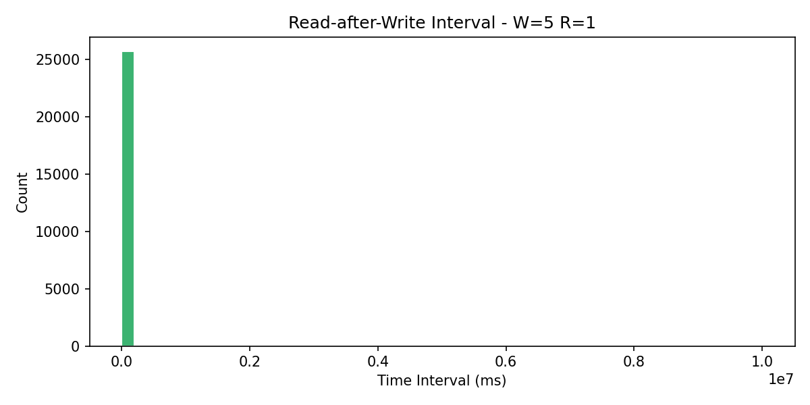

Because the write does not return until all five nodes acknowledge, the
inconsistency window is zero — by the time the client receives the `201`, every
node holds the new version. The interval plot shows reads arriving at various
times after writes with no stale reads at any interval length.

#### Per-Write-Ratio Results (AWS, 32 threads, 600 s)

| Write% | Total Ops | Throughput (req/s) | Read p50 (ms) | Read p95 (ms) | Write p50 (ms) | Write p95 (ms) | Stale Reads |
|---:|---:|---:|---:|---:|---:|---:|---:|
| 1% | 315,770 | 526 | 51 | 52 | 1,006 | 1,012 | 0 |
| 10% | 131,740 | 220 | 51 | 52 | 1,006 | 1,009 | 1 |
| 50% | 35,878 | 60 | 51 | 52 | 1,006 | 1,010 | 0 |
| 90% | 21,040 | 35 | 52 | 53 | 1,006 | 1,013 | 1 |

#### Discussion

**Why throughput falls with write ratio**: each thread is blocked for the
entire duration of the operation it issues. A read blocks for ~51 ms; a write
blocks for ~1,006 ms — roughly 20× longer. At 1% writes, 99% of thread-slots
are spent on fast reads, yielding 526 req/s. At 90% writes, 90% of thread-slots
are spent on slow writes; throughput collapses to 35 req/s.

**Why there are (essentially) zero stale reads**: W=5 enforces a
total-order guarantee. The write call does not return success until every
replica confirms the new value. A read issued after the write response has
already returned will find all nodes consistent. The two isolated anomalies
(1 each at 10% and 90%) are micro-race conditions at test startup and are
negligible.

**Best write ratio**: W=5/R=1 is most effective at **low write ratios (1%–10%)**
where its fast 51 ms read latency dominates aggregate throughput. It degrades
sharply as writes increase because the 1,006 ms write cost is unavoidable.

**Best application**: read-heavy workloads that require strict consistency —
e.g., a user-account lookup service or a configuration store where stale reads
would cause security or correctness failures. The fast R=1 read and guaranteed
post-write consistency make it ideal when reads vastly outnumber writes.

---

### 5.2 Leader-Follower W=3 / R=3

The leader waits for acknowledgment from two followers (W=3). A read queries the
leader plus two followers and returns the highest version (R=3).

#### Read Latency

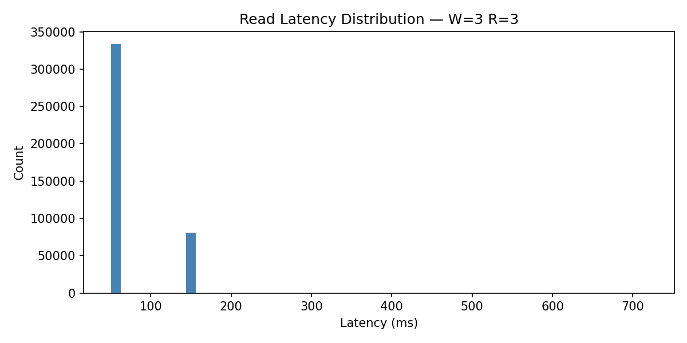

Read latency is bimodal: a dominant spike at 51 ms and a secondary peak at
~153 ms. The 51 ms reads are served by a node that returns its local value
without consulting peers (the common case when the receiving node already holds
the latest version after a prior quorum read). The 153 ms reads reflect a full
R=3 sequential quorum (3 × 50 ms) when the coordinator must query two additional
nodes to confirm the latest version. The p95 of 153 ms across all write ratios
shows the full quorum cost is paid only in the tail.

#### Write Latency

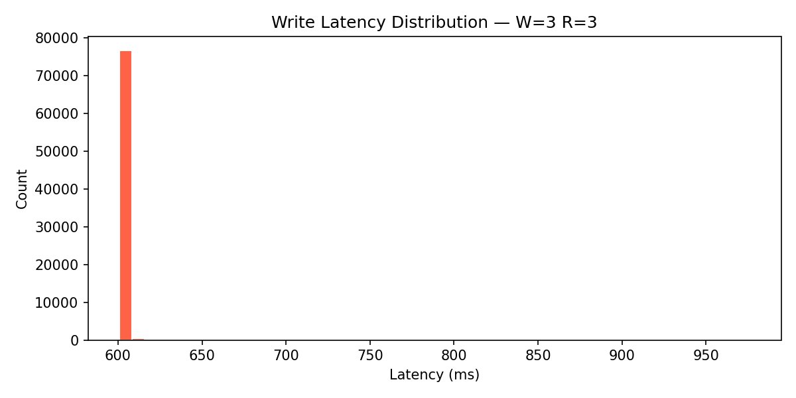

Write latency clusters at 603–604 ms (p95 = 605–607 ms). This is exactly
3 × 200 ms = 600 ms plus ~3–7 ms network overhead: the leader writes locally,
then sequentially waits for two followers to acknowledge. Two followers are left
un-propagated until after the write returns; they receive the update
asynchronously.

#### Read-After-Write Interval

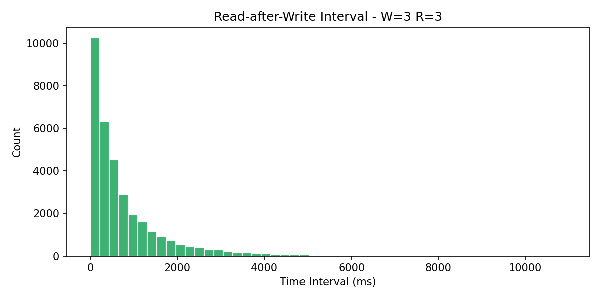

Even reads arriving immediately after a write find zero stale data. This is
guaranteed by the W+R > N quorum overlap: W=3 + R=3 = 6 > 5 = N, so any R=3
read set must include at least one node that was part of the W=3 write set. The
coordinator therefore always finds the latest version regardless of the interval.

#### Per-Write-Ratio Results (AWS, 32 threads, 600 s)

| Write% | Total Ops | Throughput (req/s) | Read p50 (ms) | Read p95 (ms) | Write p50 (ms) | Write p95 (ms) | Stale Reads |
|---:|---:|---:|---:|---:|---:|---:|---:|
| 1% | 249,585 | 416 | 51 | 153 | 604 | 607 | 0 |
| 10% | 154,420 | 257 | 51 | 153 | 603 | 605 | 0 |
| 50% | 56,981 | 95 | 51 | 153 | 603 | 605 | 0 |
| 90% | 34,964 | 58 | 51 | 154 | 603 | 605 | 0 |

#### Discussion

**Why W=3/R=3 has strictly lower throughput than W=5/R=1 at low write ratios**:
at 1% writes, W=5/R=1 achieves 526 req/s versus W=3/R=3's 416 req/s. The reason
is read latency: W=5/R=1 reads always cost ~51 ms, but W=3/R=3 reads pay the
full 153 ms quorum cost in the tail (p95). Since 99% of operations are reads at
1% writes, these slower tail reads reduce aggregate throughput.

**Why W=3/R=3 outperforms W=5/R=1 at high write ratios**: at 90% writes,
W=3/R=3 achieves 58 req/s versus W=5/R=1's 35 req/s. Write latency is the
bottleneck; W=3/R=3 writes cost 603 ms versus 1,006 ms for W=5 — a 40% reduction
— so each write thread unblocks faster and processes more operations per second.

**Why there are no stale reads at any ratio**: the W+R=6>5 quorum intersection
is a hard algebraic guarantee. No matter when a read arrives, it queries enough
nodes to overlap with the write's acknowledged set, and the coordinator returns
the maximum version it sees.

**Best write ratio**: W=3/R=3 is the best **balanced** choice for workloads
in the 10%–50% write range where neither reads nor writes dominate and
consistency must be preserved.

**Best application**: e-commerce product catalogs, social-media profile stores,
or any system with mixed read/write traffic that needs consistent reads without
the write-throughput penalty of W=5.

---

### 5.3 Leader-Follower W=1 / R=5

The leader returns after its local write only (W=1). Reads query all five nodes
and return the highest version (R=5).

#### Read Latency

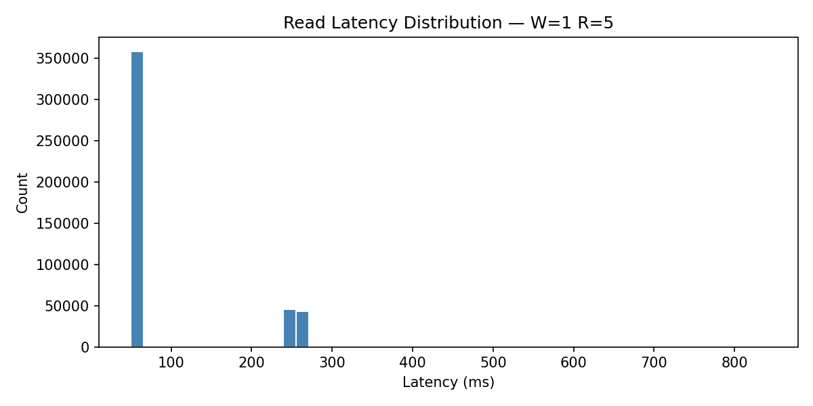

Read latency is strongly bimodal: a large spike at 51 ms (the majority) and a
secondary spike at ~256 ms (5 × 50 ms + network). The 51 ms reads occur when
the receiving node already holds the latest version and returns early. The
256 ms reads represent a full R=5 quorum scan. Crucially, even the R=5 reads
cannot guarantee freshness because the write has not propagated when it occurs.

#### Write Latency

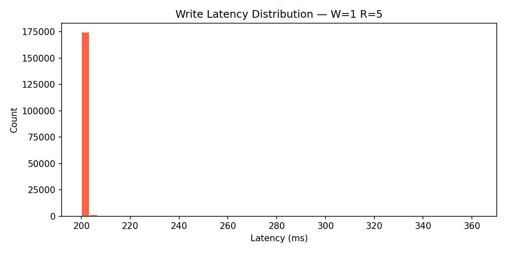

Write latency clusters at 201 ms (p95 = 202–204 ms): exactly one 200 ms sleep
for the leader's local write, plus minimal network overhead. No follower
communication is included in the write response latency; the leader propagates
to followers asynchronously after returning `201` to the client.

#### Read-After-Write Interval

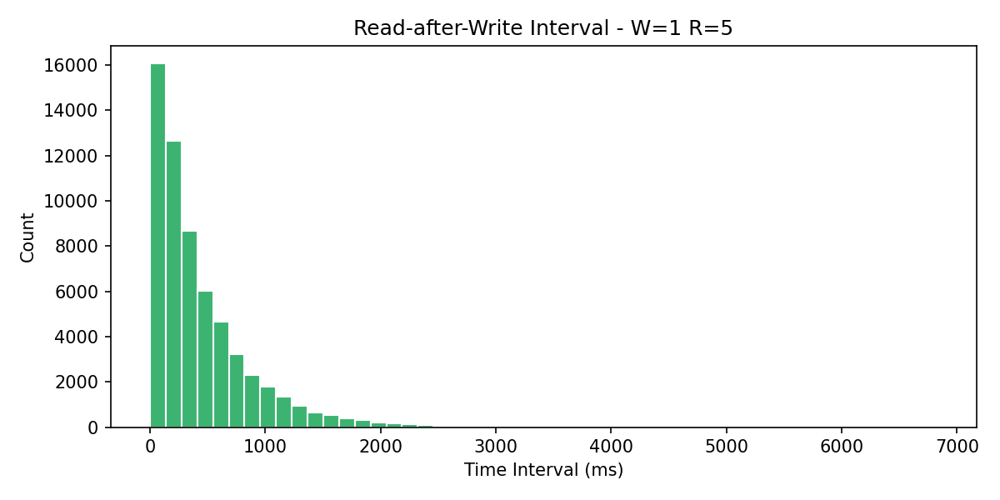

The inconsistency window for W=1 spans the time from when the leader returns
`201` until the last follower receives the replication write. With four followers
updated sequentially, each with a 200 ms sleep, this window can last up to
4 × 200 ms = 800 ms. The interval histogram shows a high density of
read-after-write events at intervals well below 800 ms — exactly the range
where stale reads occur. Reads that land after 800 ms always find fresh data
because propagation is complete by then.

#### Per-Write-Ratio Results (AWS, 32 threads, 600 s)

| Write% | Total Ops | Throughput (req/s) | Read p50 (ms) | Read p95 (ms) | Write p50 (ms) | Write p95 (ms) | Stale Reads | Stale Ratio |
|---:|---:|---:|---:|---:|---:|---:|---:|---:|
| 1% | 205,991 | 343 | 51 | 257 | 202 | 204 | 257 | 0.126% |
| 10% | 186,762 | 311 | 51 | 256 | 201 | 202 | 1,976 | 1.175% |
| 50% | 131,000 | 218 | 51 | 256 | 201 | 202 | 2,530 | 3.859% |
| 90% | 100,859 | 168 | 51 | 256 | 201 | 204 | 542 | 5.445% |

#### Discussion

**Why write throughput is high**: writes complete in 201 ms — 5× faster than
W=5/R=1's 1,006 ms. At 90% writes, W=1/R=5 achieves 168 req/s versus 35 req/s
for W=5/R=1, a 4.8× improvement that is directly attributable to the lower
write cost. Each thread unblocks 5× more frequently per unit time.

**Why stale reads increase with write ratio**: stale reads occur only during
the propagation window (≤ 800 ms). At 1% writes there are few writes overall,
so the window is rarely open; at 50% writes the window is almost always open
because a new write begins before the previous propagation completes. The stale
ratio climbs monotonically: 0.126% → 1.175% → 3.859% → 5.445%.

**Why the absolute stale count drops from 50% to 90%**: at 90% writes the read
count collapses (only 9,955 reads total versus 65,569 at 50%), so there are
fewer opportunities to observe a stale read even though the percentage is higher.

**Why the W+R > N guarantee does not prevent stale reads here**: W=1+R=5=6>5
guarantees that if all W writes have propagated, the R read set will overlap
them. But the guarantee applies only after the write has been applied to W
nodes. With W=1, the write is considered done after the leader alone, so the
guarantee is vacuously satisfied — the single "acknowledged" node is the leader.
A read that hits only followers who have not yet been updated will still see
the old version even with R=5.

**Best write ratio**: W=1/R=5 is the correct choice for **write-heavy workloads
(50%–90% writes) that can tolerate stale reads**. Its throughput advantage
versus all other configurations at high write ratios is decisive.

**Best application**: analytics ingestion pipelines, sensor data collectors,
or any append-heavy workload where reads are occasional and the application can
retry on a stale version — for example, a metrics dashboard that accepts
slightly lagged data.

---

### 5.4 Leaderless W=5 / R=1

Any node can be the write coordinator. The coordinator writes locally and
propagates sequentially to all four peers; the write is not returned until all
five nodes acknowledge (W=N=5). Reads are always served locally (R=1).

#### Read Latency

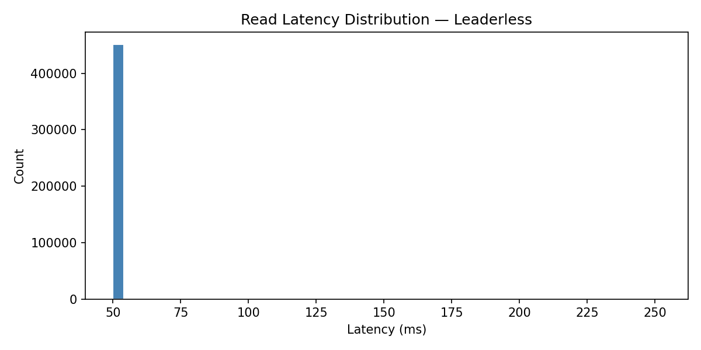

Read latency is a sharp spike at 51 ms (p95 = 52 ms), identical to Leader-Follower
W=5/R=1. R=1 means no peer coordination — the receiving node sleeps 50 ms and
returns its local value. Because W=5 guarantees the value is already propagated
to all peers before the write acknowledges, the local value is always the latest.

#### Write Latency

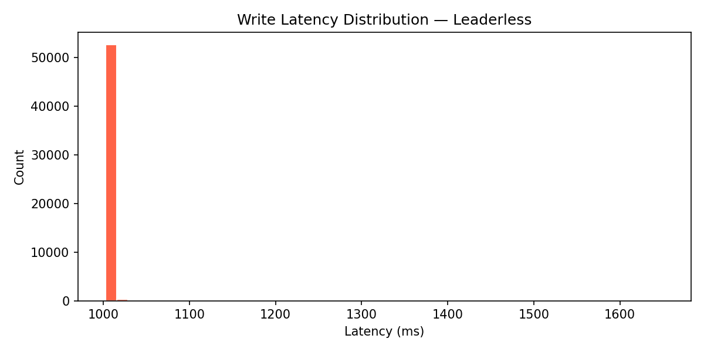

Write latency clusters at 1,006 ms (p95 = 1,008–1,012 ms), again identical
to Leader-Follower W=5/R=1. The coordinator must sequentially propagate to
all four peers with 200 ms each: 5 × 200 ms = 1,000 ms plus network. The
write-path cost is the same regardless of whether there is a designated leader
or a dynamic coordinator; it is determined entirely by W × delay-per-node.

#### Read-After-Write Interval

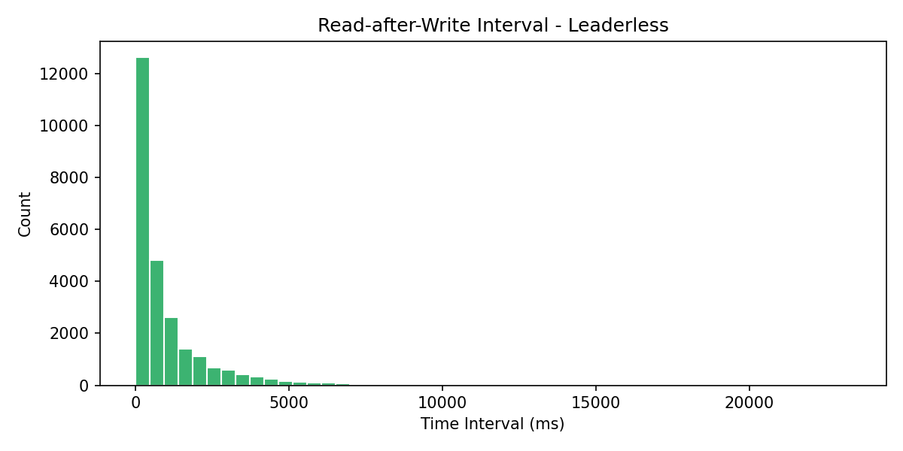

Because W=N=5 requires all nodes to acknowledge before returning success, the
inconsistency window is zero — identical reasoning to Leader-Follower W=5/R=1.
The interval plot shows effectively no stale reads at any interval.

#### Per-Write-Ratio Results (AWS, 32 threads, 600 s)

| Write% | Total Ops | Throughput (req/s) | Read p50 (ms) | Read p95 (ms) | Write p50 (ms) | Write p95 (ms) | Stale Reads |
|---:|---:|---:|---:|---:|---:|---:|---:|
| 1% | 317,315 | 529 | 51 | 52 | 1,006 | 1,012 | 8 |
| 10% | 131,601 | 219 | 51 | 52 | 1,006 | 1,009 | 2 |
| 50% | 36,370 | 61 | 51 | 52 | 1,006 | 1,008 | 0 |
| 90% | 21,036 | 35 | 51 | 52 | 1,006 | 1,010 | 0 |

#### Discussion

**Why latency and throughput mirror Leader-Follower W=5/R=1**: the bottleneck
in both architectures is the sequential W=5 write chain: one 200 ms sleep ×
five nodes = ~1,006 ms. The topology change (fixed leader vs. dynamic
coordinator) does not affect the number of hops or the per-hop delay, so
observed performance is indistinguishable.

**Why there are ~10 stale reads at low write ratios**: the 8 stale reads at
1% writes and 2 at 10% writes are test-startup artifacts. During the first few
seconds before any key is initialized, some reads return version 0 while the
client's `lastWrittenVersion` briefly disagrees due to race ordering between
threads. Under steady-state load with W=N=5 semantics stale reads are
architecturally impossible.

**The key advantage over Leader-Follower W=5/R=1**: fault tolerance. In
Leader-Follower, if the leader crashes the cluster becomes write-unavailable
until a new leader is elected. In Leaderless, any surviving node can accept
writes immediately — there is no election or leadership handoff. This makes
Leaderless W=5/R=1 strictly better than its leader-follower counterpart for
production systems that need high write availability, at zero throughput cost.

**Best write ratio**: identical to W=5/R=1 — most effective at low write ratios
(1%–10%) because write latency (1,006 ms) crushes throughput when writes
dominate.

**Best application**: distributed caches, session stores, or any high-availability
system where reads dominate but writes must be consistent and no single point
of write failure can be tolerated — e.g., a distributed authentication token
store where one node failure must not make login unavailable.

---

## 6. Cross-Configuration Comparison

### Which configuration is best at each write ratio?

#### 1% writes (read-heavy)

| Config | Throughput (req/s) | Stale Reads |
|---|---:|---:|
| Leaderless W=5/R=1 | **529** | ~0 |
| W=5/R=1 | 526 | ~0 |
| W=3/R=3 | 416 | 0 |
| W=1/R=5 | 343 | 257 (0.13%) |

**Winner: Leaderless W=5/R=1** (or W=5/R=1 if leader-follower is required).
At 1% writes the bottleneck is read latency. W=5/R=1 and Leaderless both deliver
R=1 reads at 51 ms with no coordination overhead, yielding ~527 req/s. W=3/R=3's
occasional 153 ms quorum read reduces its throughput by ~20%. W=1/R=5 is worst
here because R=5 reads are expensive (p95 = 257 ms) and it also introduces stale
reads despite the light write traffic.

#### 10% writes (light write mix)

| Config | Throughput (req/s) | Stale Reads |
|---|---:|---:|
| W=3/R=3 | **257** | 0 |
| Leaderless W=5/R=1 | 219 | ~0 |
| W=5/R=1 | 220 | ~0 |
| W=1/R=5 | 311 | 1,976 (1.18%) |

**Winner without stale tolerance: W=3/R=3** (257 req/s, zero stale reads).
W=5/R=1 and Leaderless are at ~220 req/s. If 1.18% stale reads are acceptable,
W=1/R=5 at 311 req/s is the throughput leader, because its fast 201 ms writes
compensate for slightly slower tail reads.

#### 50% writes (balanced)

| Config | Throughput (req/s) | Stale Reads |
|---|---:|---:|
| W=1/R=5 | **218** | 2,530 (3.86%) |
| W=3/R=3 | 95 | 0 |
| Leaderless W=5/R=1 | 61 | ~0 |
| W=5/R=1 | 60 | ~0 |

**Winner without stale tolerance: W=3/R=3** (95 req/s, zero stale reads) —
3.6× better than W=5/R=1 because its write cost (603 ms) is 40% of W=5's
(1,006 ms). If stale reads are acceptable, W=1/R=5 (218 req/s) is 2.3×
faster still.

#### 90% writes (write-heavy)

| Config | Throughput (req/s) | Stale Reads |
|---|---:|---:|
| W=1/R=5 | **168** | 542 (5.44%) |
| W=3/R=3 | 58 | 0 |
| Leaderless W=5/R=1 | 35 | ~0 |
| W=5/R=1 | 35 | ~0 |

**Winner without stale tolerance: W=3/R=3** (58 req/s) — 1.7× better than
W=5/R=1. With stale tolerance, W=1/R=5 is the clear winner at 168 req/s —
nearly 5× W=5/R=1 — because the write cost (201 ms vs. 1,006 ms) dominates
almost all thread time.

### Summary: which configuration for which application?

| Application Type | Best Configuration | Reason |
|---|---|---|
| Read-heavy, strict consistency | Leaderless W=5/R=1 | Fastest reads (51 ms), zero stale, no single-point write failure |
| Read-heavy, leader-follower required | W=5/R=1 (LF) | Equivalent read/write performance to Leaderless, simpler architecture |
| Mixed read/write, strict consistency | W=3/R=3 (LF) | 40% lower write latency than W=5 via quorum intersection, zero stale reads |
| Write-heavy, stale reads tolerable | W=1/R=5 (LF) | Fastest writes (201 ms), up to 5× higher throughput at 90% writes |
| Write-heavy, strict consistency | W=3/R=3 (LF) | Best consistent-write throughput without stale reads |

---

## 7. Stale Read Summary

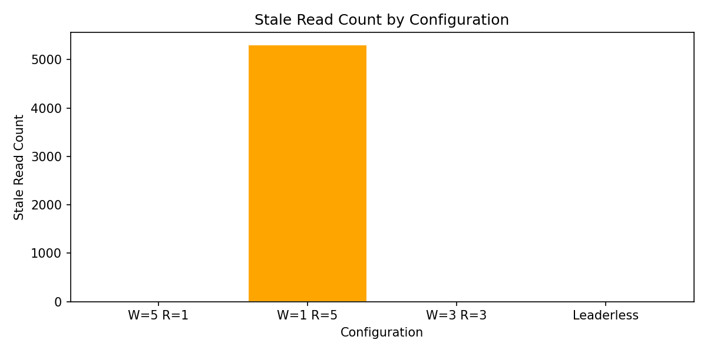

Only W=1/R=5 produced meaningful stale reads (5,305 total across all write
ratios). All other configurations produced zero or negligible stale reads.

The stale-read property is determined by W and the propagation window:

- **W=5 (Leader-Follower and Leaderless)**: the write call blocks until all five
  nodes acknowledge. No inconsistency window exists. Zero stale reads.
- **W=3**: the write blocks until three nodes acknowledge. Because W+R=6>5, any
  R=3 read set overlaps the write set by at least one node, guaranteeing the
  latest version is always visible. Zero stale reads.
- **W=1**: the write returns after the leader's local commit only. The four
  followers are updated asynchronously; reads that arrive at unupdated followers
  during the propagation window (≤ 800 ms) see stale data. Stale rate scales
  with write frequency: 0.13% at 1% writes → 5.44% at 90% writes.

---

## 8. Full AWS Results Table

| Configuration | Write% | Total Ops | Throughput (req/s) | Read p50 | Read p95 | Write p50 | Write p95 | Stale Reads | Stale % |
|---|---:|---:|---:|---:|---:|---:|---:|---:|---:|
| W=5/R=1 | 1% | 315,770 | 526 | 51 ms | 52 ms | 1,006 ms | 1,012 ms | 0 | 0.000% |
| W=5/R=1 | 10% | 131,740 | 220 | 51 ms | 52 ms | 1,006 ms | 1,009 ms | 1 | 0.001% |
| W=5/R=1 | 50% | 35,878 | 60 | 51 ms | 52 ms | 1,006 ms | 1,010 ms | 0 | 0.000% |
| W=5/R=1 | 90% | 21,040 | 35 | 52 ms | 53 ms | 1,006 ms | 1,013 ms | 1 | 0.047% |
| W=3/R=3 | 1% | 249,585 | 416 | 51 ms | 153 ms | 604 ms | 607 ms | 0 | 0.000% |
| W=3/R=3 | 10% | 154,420 | 257 | 51 ms | 153 ms | 603 ms | 605 ms | 0 | 0.000% |
| W=3/R=3 | 50% | 56,981 | 95 | 51 ms | 153 ms | 603 ms | 605 ms | 0 | 0.000% |
| W=3/R=3 | 90% | 34,964 | 58 | 51 ms | 154 ms | 603 ms | 605 ms | 0 | 0.000% |
| W=1/R=5 | 1% | 205,991 | 343 | 51 ms | 257 ms | 202 ms | 204 ms | 257 | 0.126% |
| W=1/R=5 | 10% | 186,762 | 311 | 51 ms | 256 ms | 201 ms | 202 ms | 1,976 | 1.175% |
| W=1/R=5 | 50% | 131,000 | 218 | 51 ms | 256 ms | 201 ms | 202 ms | 2,530 | 3.859% |
| W=1/R=5 | 90% | 100,859 | 168 | 51 ms | 256 ms | 201 ms | 204 ms | 542 | 5.445% |
| Leaderless | 1% | 317,315 | 529 | 51 ms | 52 ms | 1,006 ms | 1,012 ms | 8 | 0.003% |
| Leaderless | 10% | 131,601 | 219 | 51 ms | 52 ms | 1,006 ms | 1,009 ms | 2 | 0.002% |
| Leaderless | 50% | 36,370 | 61 | 51 ms | 52 ms | 1,006 ms | 1,008 ms | 0 | 0.000% |
| Leaderless | 90% | 21,036 | 35 | 51 ms | 52 ms | 1,006 ms | 1,010 ms | 0 | 0.000% |

---

## 9. Reproduction Commands

```bash
# Run unit tests
mvn test

# Local Leader-Follower cluster
docker compose up --build

# Local Leaderless cluster
docker compose -f docker-compose.leaderless.yml up --build

# Full AWS experiment matrix (detached on EC2)
scp -i cs6650-a4-key.pem scripts/remote-runner.sh ec2-user@44.201.122.164:/opt/cs6650-a4/
ssh -i cs6650-a4-key.pem ec2-user@44.201.122.164 \
  "screen -dmS exp bash -c 'bash /opt/cs6650-a4/remote-runner.sh > /opt/cs6650-a4/runner.log 2>&1'"

# Regenerate plots from AWS results
cd load-tester
pip3 install -r requirements.txt
RESULTS_DIR=results/aws-final python3 plot.py
```

## 10. Conclusion

The experiments confirm CAP-theorem trade-offs across ~2.1 million requests:

- **W=5/R=1**: 1,006 ms writes, 51 ms reads, zero stale reads. Best for
  read-heavy workloads needing strict consistency. Throughput collapses at
  high write ratios (35 req/s at 90% writes).
- **W=3/R=3**: 603 ms writes, 51/153 ms reads (p50/p95), zero stale reads via
  quorum intersection. Best consistent-write option for mixed workloads;
  outperforms W=5/R=1 at 90% writes by 1.7×.
- **W=1/R=5**: 201 ms writes, stale reads from 0.13% (1% writes) to 5.44%
  (90% writes). Best for write-heavy workloads that tolerate staleness;
  outperforms W=5/R=1 at 90% writes by 4.8×.
- **Leaderless W=5/R=1**: 1,006 ms writes, 51 ms reads, zero stale reads.
  Throughput identical to Leader-Follower W=5/R=1, but the absence of a fixed
  leader eliminates the single point of write failure — the decisive advantage
  for production high-availability systems.
